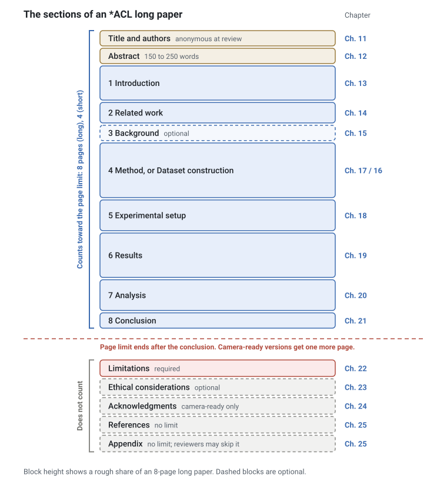

Open any long paper from a recent ACL and you will find nearly the same headings in nearly the same order: Introduction, Related Work, a section on the method or the data, Experiments, Results, Analysis, Conclusion, then Limitations and References. Reviewers read with that outline in their heads. A paper that follows it puts the claim, the evidence and the caveats where the reviewer looks for them. This chapter maps the outline. Chapters 11 to 25 then take each part in turn.

## The page budget

The ARR call for papers sets the limits ([ARR call](https://aclrollingreview.org/cfp)). A long paper gets "up to eight (8) pages of content" and a short paper "up to four (4) pages of content." Everything from the title to the end of the conclusion counts, including every figure and table in the main text. After the conclusion you get unlimited space for the Limitations section, an optional Ethical considerations section, and the references. The call is blunt about the penalty: "Submissions that exceed the length requirements, or are missing a limitations section, will be desk rejected."

Three more rules come from the [ACL formatting guidelines](https://acl-org.github.io/ACLPUB/formatting.html). Accepted papers get one extra page, nine for long and five for short, so you can answer the reviewers. Acknowledgments go "immediately before the references," do not count toward the limit, and are left out of the review version. Appendices are welcome and do not count either, but "it is optional for reviewers to look at appendices or supplementary material." Anything a reviewer needs to accept the paper belongs in the eight pages.

## The sections and their jobs

Each section answers one question a reader brings to the paper. The lengths below are our rule of thumb for an eight-page long paper. Your paper will differ, but a section that is three times this size is usually doing a second job that belongs elsewhere.

| Section | The question it answers | Rough length | Chapter |
|---|---|---|---|
| Title | What is this paper about? | One line | [11](./11-title.md) |
| Abstract | What did you do, and what did you find? | 150 to 250 words | [12](./12-abstract.md) |
| Introduction | Why does this problem matter, what is missing, and what do you contribute? | About one page | [13](./13-introduction.md) |
| Related work | How does this paper differ from the closest work? | Half a page to a page | [14](./14-related-work.md) |
| Background | What notation and prior technique does the method build on? | A few paragraphs, or none | [15](./15-background.md) |
| Dataset construction | Where did the data come from, and can it be trusted? (resource papers) | One to two pages | [16](./16-dataset-construction.md) |
| Method | What exactly did you build? | One and a half to two pages | [17](./17-methods.md) |
| Experimental setup | What did you compare against, on what data, with which metrics? | About a page | [18](./18-experimental-setup.md) |
| Results | What are the numbers, and what do they show? | One to one and a half pages | [19](./19-results.md) |
| Analysis | Why does it work, and where does it fail? | About a page | [20](./20-analysis.md) |
| Conclusion | What does the reader now know? | One paragraph | [21](./21-conclusion.md) |
| Limitations | Where do the claims stop holding? (required) | Half a page | [22](./22-limitations.md) |
| Ethical considerations | Who could be harmed, and what did you do about it? (optional) | Half a page | [23](./23-ethics.md) |
| Acknowledgments | Who funded and helped the work? Where did you use AI tools? (camera-ready only) | A few lines | [24](./24-ai-assistance.md) |
| References and appendix | Where can a reader check every claim and every setting? | No limit | [25](./25-references-and-appendices.md) |

The first three rows carry most of the weight. Many readers stop after the abstract. A reviewer has usually formed a view by the end of the introduction. A reviewer who reaches section 4 already expects a particular result. The middle sections, from method to analysis, supply the evidence for that result. The back matter tells the reader how far to trust it.

## Four real outlines

The template bends to fit the contribution. Here are the top-level headings of four well-known papers, copied from the published versions.

| Paper | Kind | Section headings |
|---|---|---|
| *[BERT](https://aclanthology.org/N19-1423/)* (Devlin et al., NAACL 2019) | Long, method | 1 Introduction, 2 Related Work, 3 BERT, 4 Experiments, 5 Ablation Studies, 6 Conclusion |
| *[Beyond Accuracy: Behavioral Testing of NLP Models with CheckList](https://aclanthology.org/2020.acl-main.442/)* (Ribeiro et al., ACL 2020) | Long, evaluation | 1 Introduction, 2 CheckList, 3 Testing SOTA models with CheckList, 4 User Evaluation, 5 Related Work, 6 Conclusion |
| *[BERT Rediscovers the Classical NLP Pipeline](https://aclanthology.org/P19-1452/)* (Tenney et al., ACL 2019) | Short, analysis | 1 Introduction, 2 Model, 3 Metrics, 4 Results, 5 Conclusion |
| *[AfriSenti](https://aclanthology.org/2023.emnlp-main.862/)* (Muhammad et al., EMNLP 2023) | Long, resource | 1 Introduction, 2 Related Work, 3 Overview of the AfriSenti Datasets, 4 Data Collection and Processing, 5 Data Annotation Challenges, 6 Experiments, 7 Conclusion and Future Work, 8 Ethics Statement, 9 Limitations |

Four habits show up across them.

**The method section takes the method's name.** BERT calls section 3 "BERT" and CheckList calls section 2 "CheckList." A reader scanning the headings learns what the paper built. "Our Approach" or "Proposed Method" tells them nothing.

**Related work can move to the end.** CheckList puts it in section 5, after the reader has seen the method. The comparison only makes sense once the reader knows what is being compared. Put related work early when the reader needs it to understand the gap. Put it late when the reader needs your method to understand the difference.

**Short papers drop sections.** Tenney et al. have no Related Work or Analysis section. The introduction carries the citations and the results section carries the interpretation. Four pages leave no room for a section that holds one paragraph.

**Resource papers replace the method with the data.** AfriSenti spends three sections on what the data is, how it was collected and what went wrong in annotation, then one section on experiments. The experiments show what the data supports. They are not the contribution.

## How the outline changes with the paper type

[Chapter 3](./03-paper-types.md) lists the paper types and [Chapter 4](./04-contribution.md) the kinds of contribution. The front and back of the paper stay the same for all of them. The middle changes.

| Paper type | What fills the middle |
|---|---|
| Method | Method, experimental setup, results, analysis |
| Resource | Dataset construction (often two or three sections), then baseline experiments and an analysis of the data |
| Analysis | The question, the probing or evaluation setup, findings organised by question |
| Short | One focused method or finding, with results and discussion merged; related work folded into the introduction |
| Survey | A taxonomy section, then one section per branch of the taxonomy, then open problems |
| Position | The claim, the evidence and arguments for it, the counterarguments, and what the field should do |

## Write in a different order

Readers go from title to appendix. Writers should not. Most experienced authors draft the results first, then the method that produced them, then the introduction that promises them, and the abstract last. [Chapter 6](./06-framing.md) describes this backwards order in detail. The outline in this chapter is where the paper ends up, and it makes a good checklist once a draft exists.

## Common mistakes

- **The key result lives in the appendix.** Reviewers may skip the appendix, and the guidelines allow it. Any result the paper's claim depends on goes in the main text.
- **Generic section names.** "Our Approach," "Experiments and Results," "Discussion." Name the method, the dataset or the question instead.
- **A related work section that lists papers.** It should place your paper among them. [Chapter 14](./14-related-work.md) shows how.
- **A conclusion that repeats the abstract.** Say what the reader now knows and what remains open, in a paragraph.
- **New material in Limitations or Ethics.** These sections sit outside the page limit, and the formatting rules say the Limitations section "may not contain any additional experiments, figures or analysis." Do not use them to smuggle in results.
- **Missing Limitations section.** It is a desk reject, whatever the quality of the rest.

## Further reading

- The [ARR call for papers](https://aclrollingreview.org/cfp) for the current page limits, and the [ACL formatting guidelines](https://acl-org.github.io/ACLPUB/formatting.html) for section order and what counts toward the limit.
- [Chapter 9](./09-figures-and-tables.md) on figures and tables, which use the same page budget as the text.
