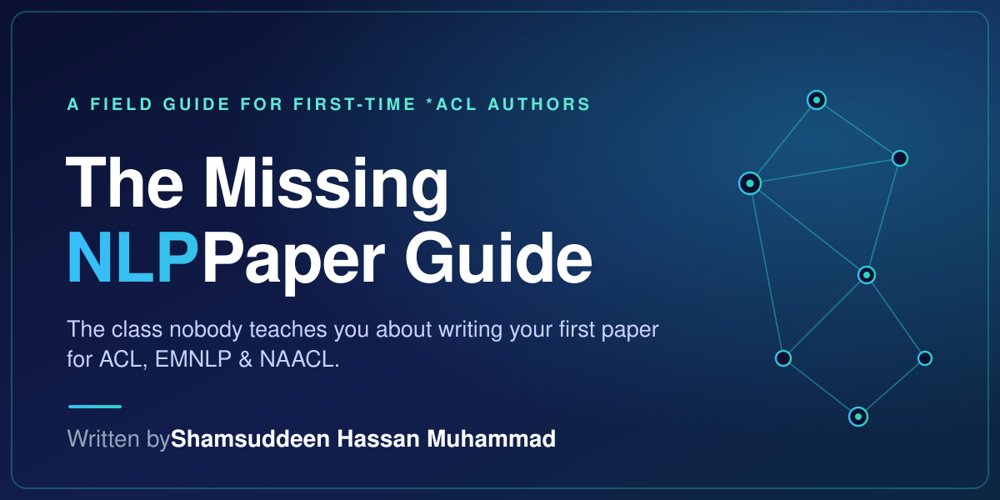

# The Missing NLP Paper Guide

**The class nobody teaches you: how to actually write your first paper for ACL, EMNLP, NAACL, EACL, and the rest of the \*ACL family.**

---

## Why this exists

There is a class your PhD program does not teach. Your advisor assumes you picked it up by osmosis. Your peers pretend they already know it. The official ACL author guidelines tell you the *format* of a paper — margins, citation style, page limits — but not the *craft*. How do you actually frame a contribution? What goes in a related work section that is not just a list of citations? Why does your introduction feel flat? Why did the reviewer say your results section was "hard to follow" when the numbers are right there?

This is the missing class. Inspired in spirit by MIT's [Missing Semester of Your CS Education](https://missing.csail.mit.edu/) — the course that finally taught students the command line, version control, and debugging tools nobody had bothered to teach them — this guide tries to do the same for \*ACL paper writing. It is the missing methods seminar.

## Who this is for

- **First-time \*ACL authors** — PhD students, MS students, or industry researchers with a result and a deadline.
- **Advisors** who want a single artifact to hand new students instead of explaining the same things every cycle.
- **Reading groups** running a "how to write papers" session.

If you have published five or more first-author \*ACL papers, this guide is probably below your level. We would, however, love your contributions.

## What you get

- 29 chapters covering every section of an \*ACL paper, plus the publication landscape, collaboration, figures, rebuttals, reviewing, and what to do after the decision.
- Five concrete examples from real ACL/EMNLP/NAACL papers in each chapter — not invented examples.
- A **phrasebook of rhetorical moves** in each chapter — verbatim openings, pivots, and closings drawn from highly-cited NLP papers, grouped by the job they do (context, gap, proposal, method, result, implication). Inspired by the [Manchester Academic Phrasebook](https://www.phrasebank.manchester.ac.uk/), but calibrated to \*ACL conventions and built from real papers rather than generic academic English.
- A [printable one-page submission checklist](./checklists/submission-checklist.md).
- A `papers-to-read.bib` with every paper cited in Chapter 28, ready to drop into Overleaf.
- A [structured examples database](./examples/README.md) you can browse by section or by paper.

## What this is *not*

- It is **not** the official ACL author guidelines. For format, page limits, anonymity rules, and the Responsible NLP Checklist, see the [ACL Rolling Review CFP](https://aclrollingreview.org/cfp) and the [ACLPUB formatting page](https://acl-org.github.io/ACLPUB/formatting.html). When the official guidelines and this guide disagree, the official guidelines win.
- It is **not** AI-generated filler. Every example links to a real paper on the [ACL Anthology](https://aclanthology.org).
- It is **not** a substitute for actually reading great papers. Chapter 28 tells you which ones.

## How to use it

Pick the track that matches your situation.

| Your situation | Read these chapters |
|---|---|
| **Speed run** (deadline in 2 weeks, paper mostly drafted) | [10 Abstract](./chapters/10-abstract.md), [11 Introduction](./chapters/11-introduction.md), [17 Results](./chapters/17-results.md), [20 Limitations](./chapters/20-limitations.md), [29 Checklist](./chapters/29-checklist.md) |
| **First paper** (you have 6–8 weeks) | All chapters, in order |
| **First-timer to NLP** (deciding where to submit) | [1 Publication Landscape](./chapters/01-publication-landscape.md), [2 Understanding the Field](./chapters/02-understanding-the-field.md), [5 Framing](./chapters/05-framing.md), [28 Best Papers](./chapters/28-best-papers.md) |
| **Studying the craft** (no deadline, want to get better) | [2 Understanding the Field](./chapters/02-understanding-the-field.md), [5 Framing](./chapters/05-framing.md), [28 Best Papers](./chapters/28-best-papers.md), then any chapter that scratches an itch |
| **Reviewing**, not writing | [25 How to Review Well](./chapters/25-reviewing.md), [18 Analysis](./chapters/18-analysis.md), [20 Limitations](./chapters/20-limitations.md), [28 Best Papers](./chapters/28-best-papers.md) |

## Chapters

1. [The NLP Publication Landscape](./chapters/01-publication-landscape.md)
2. [Understanding the Field](./chapters/02-understanding-the-field.md)
3. [What Kind of Paper Are You Writing?](./chapters/03-paper-types.md)
4. [Decoding the Jargon](./chapters/04-jargon.md)
5. [Before You Write](./chapters/05-framing.md)
6. [Working With Advisors and Co-authors](./chapters/06-collaboration.md)
7. [Writing Clearly](./chapters/07-writing-clearly.md)
8. [Figures and Tables That Work](./chapters/08-figures-and-tables.md)
9. [The Title](./chapters/09-title.md)
10. [The Abstract](./chapters/10-abstract.md)
11. [The Introduction](./chapters/11-introduction.md)
12. [Related Work](./chapters/12-related-work.md)
13. [Background / Preliminaries](./chapters/13-background.md)
14. [Dataset Construction](./chapters/14-dataset-construction.md)
15. [Methods](./chapters/15-methods.md)
16. [Experimental Setup](./chapters/16-experimental-setup.md)
17. [Results](./chapters/17-results.md)
18. [Analysis and Discussion](./chapters/18-analysis.md)
19. [Conclusion](./chapters/19-conclusion.md)
20. [Limitations (Required)](./chapters/20-limitations.md)
21. [Ethical Considerations](./chapters/21-ethics.md)
22. [Using AI Tools Responsibly](./chapters/22-ai-assistance.md)
23. [References & Appendices](./chapters/23-references-and-appendices.md)
24. [The Rebuttal](./chapters/24-rebuttal.md)
25. [How to Review Well](./chapters/25-reviewing.md)
26. [After Rejection](./chapters/26-after-rejection.md)
27. [After Acceptance](./chapters/27-after-acceptance.md)
28. [Best Papers Worth Reading](./chapters/28-best-papers.md)
29. [A Final Checklist](./chapters/29-checklist.md)

## Contributing

Yes, please. The guide is better when more experienced authors share what they have learned. See [CONTRIBUTING.md](https://github.com/shmuhammadd/missing-guide-nlp/blob/main/CONTRIBUTING.md) in the repo.

## License

[CC BY 4.0](https://github.com/shmuhammadd/missing-guide-nlp/blob/main/LICENSE). Use it, fork it, translate it, hand it to your students. Attribution appreciated.
