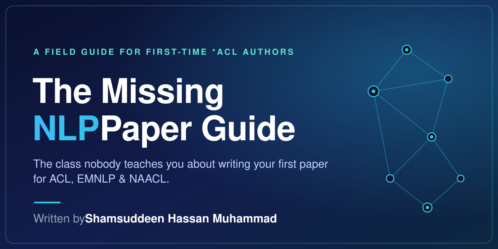

# The Missing NLP Paper Guide

**The class nobody teaches you: how to write your first paper for ACL, EMNLP, NAACL, EACL, and the rest of the \*ACL family.**

---

## Why this exists

Your PhD program does not teach you how to write a paper. Your advisor assumes you picked it up by osmosis. Your peers pretend they already know how. The official ACL author guidelines cover the *format* of a paper: margins, citation style, page limits. They say nothing about the *craft*. They will not show you how to frame a contribution, or what a related work section needs beyond a list of citations. Nor will they explain why your introduction feels flat, or why a reviewer called your results section "hard to follow" when the numbers are right there.

This guide is that missing class. MIT's [Missing Semester of Your CS Education](https://missing.csail.mit.edu/) taught students the command line, version control, and debugging tools that nobody had bothered to teach them. We try to do the same for \*ACL paper writing, as the methods seminar your program never ran.

## Who this is for

- **First-time \*ACL authors**: PhD students, MS students, or industry researchers with a result and a deadline.
- **Advisors** who want a single artifact to hand new students instead of explaining the same things every cycle.
- **Reading groups** running a "how to write papers" session.

If you have published five or more first-author \*ACL papers, this guide is probably below your level. We would still love your contributions.

## What you get

- 31 chapters covering every section of an \*ACL paper, plus where to publish, collaboration, figures, rebuttals, reviewing, and what to do after the decision.
- Five examples from real ACL/EMNLP/NAACL papers in each chapter. None are invented.
- A **phrasebook of rhetorical moves** in each chapter: verbatim openings, pivots, and closings from highly-cited NLP papers. We group them by the job they do (context, gap, proposal, method, result, implication). The idea comes from the [Manchester Academic Phrasebook](https://www.phrasebank.manchester.ac.uk/), but our phrases follow \*ACL conventions and come from real papers instead of generic academic English.
- A [printable one-page submission checklist](./checklists/submission-checklist.md).
- A `papers-to-read.bib` with every paper cited in Chapter 30, ready to drop into Overleaf.
- A [structured examples database](./examples/README.md) you can browse by section or by paper.

## What this is *not*

- It is **not** the official ACL author guidelines. For format, page limits, anonymity rules, and the Responsible NLP Checklist, see the [ACL Rolling Review CFP](https://aclrollingreview.org/cfp) and the [ACLPUB formatting page](https://acl-org.github.io/ACLPUB/formatting.html). When the official guidelines and this guide disagree, the official guidelines win.
- It is **not** AI-generated filler. Every example links to a real paper on the [ACL Anthology](https://aclanthology.org).
- It is **not** a substitute for reading great papers. Chapter 30 tells you which ones.

## How to use it

Pick the track that matches your situation.

| Your situation | Read these chapters |
|---|---|
| **Speed run** (deadline in 2 weeks, paper mostly drafted) | [12 Abstract](./chapters/12-abstract.md), [13 Introduction](./chapters/13-introduction.md), [19 Results](./chapters/19-results.md), [22 Limitations](./chapters/22-limitations.md), [31 Checklist](./chapters/31-checklist.md) |
| **First paper** (you have 6–8 weeks) | All chapters, in order |
| **First-timer to NLP** (deciding where to submit) | [1 Publication Landscape](./chapters/01-publication-landscape.md), [2 Understanding the Field](./chapters/02-understanding-the-field.md), [4 Contribution](./chapters/04-contribution.md), [6 Framing](./chapters/06-framing.md), [30 Best Papers](./chapters/30-best-papers.md) |
| **Studying the craft** (no deadline, want to get better) | [2 Understanding the Field](./chapters/02-understanding-the-field.md), [4 Contribution](./chapters/04-contribution.md), [6 Framing](./chapters/06-framing.md), [30 Best Papers](./chapters/30-best-papers.md), then any chapter that scratches an itch |
| **Reviewing**, not writing | [27 How to Review Well](./chapters/27-reviewing.md), [20 Analysis](./chapters/20-analysis.md), [22 Limitations](./chapters/22-limitations.md), [30 Best Papers](./chapters/30-best-papers.md) |

## Chapters

1. [The NLP Publication Landscape](./chapters/01-publication-landscape.md)
2. [Understanding the Field](./chapters/02-understanding-the-field.md)
3. [What Kind of Paper Are You Writing?](./chapters/03-paper-types.md)
4. [What Counts as a Contribution?](./chapters/04-contribution.md)
5. [Decoding the Jargon](./chapters/05-jargon.md)
6. [Before You Write](./chapters/06-framing.md)
7. [Working With Advisors and Co-authors](./chapters/07-collaboration.md)
8. [Writing Clearly](./chapters/08-writing-clearly.md)
9. [Figures and Tables That Work](./chapters/09-figures-and-tables.md)
10. [The Structure of an \*ACL Paper](./chapters/10-paper-structure.md)
11. [The Title](./chapters/11-title.md)
12. [The Abstract](./chapters/12-abstract.md)
13. [The Introduction](./chapters/13-introduction.md)
14. [Related Work](./chapters/14-related-work.md)
15. [Background / Preliminaries](./chapters/15-background.md)
16. [Dataset Construction](./chapters/16-dataset-construction.md)
17. [Methods](./chapters/17-methods.md)
18. [Experimental Setup](./chapters/18-experimental-setup.md)
19. [Results](./chapters/19-results.md)
20. [Analysis and Discussion](./chapters/20-analysis.md)
21. [Conclusion](./chapters/21-conclusion.md)
22. [Limitations (Required)](./chapters/22-limitations.md)
23. [Ethical Considerations](./chapters/23-ethics.md)
24. [Using AI Tools Responsibly](./chapters/24-ai-assistance.md)
25. [References & Appendices](./chapters/25-references-and-appendices.md)
26. [The Rebuttal](./chapters/26-rebuttal.md)
27. [How to Review Well](./chapters/27-reviewing.md)
28. [After Rejection](./chapters/28-after-rejection.md)
29. [After Acceptance](./chapters/29-after-acceptance.md)
30. [Best Papers Worth Reading](./chapters/30-best-papers.md)
31. [A Final Checklist](./chapters/31-checklist.md)

## Contributing

Yes, please. The guide improves each time an experienced author shares what they have learned. See [CONTRIBUTING.md](https://github.com/shmuhammadd/missing-guide-nlp/blob/main/CONTRIBUTING.md) in the repo.

## License

[CC BY 4.0](https://github.com/shmuhammadd/missing-guide-nlp/blob/main/LICENSE). Use it, fork it, translate it, hand it to your students. Attribution appreciated.
